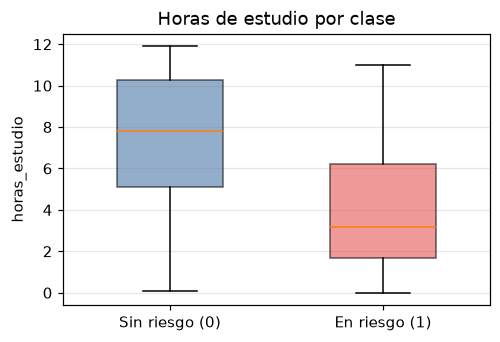
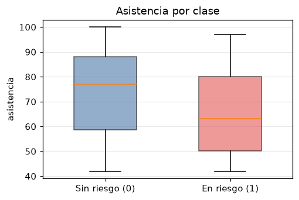
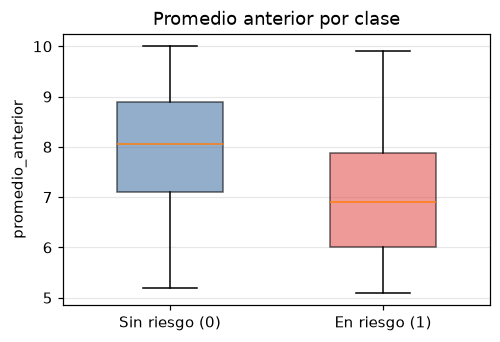
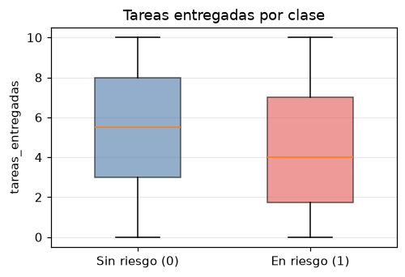
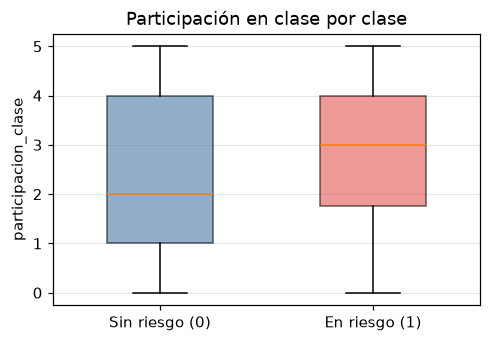
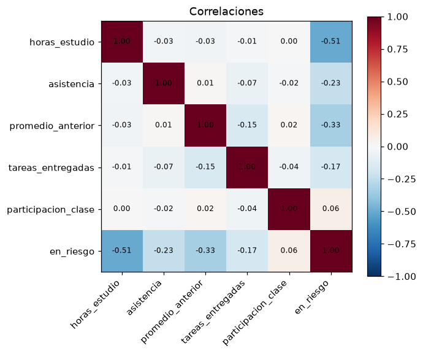
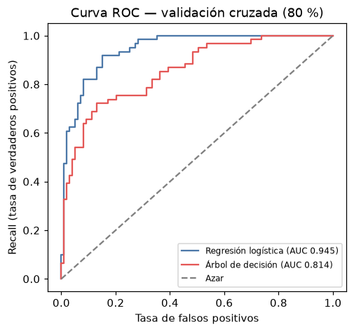
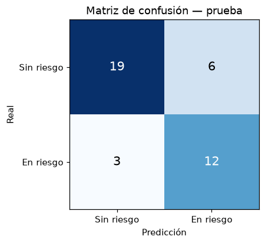
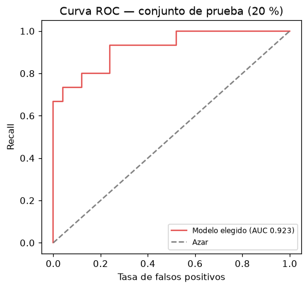

# Reporte de entrenamiento — Clasificador de alumnos en riesgo

> Generado automáticamente por `python -m src.entrenamiento`.

## 1. Análisis de datos

- Registros: **200** · columnas: **6**
- Valores faltantes: **0**
- Filas duplicadas: **0**
- Clase objetivo: 124 sin riesgo (62%) · 76 en riesgo (38%) → desbalance moderado.

### Columnas

| columna | tipo | mínimo | máximo | media | faltantes | valores únicos |
|---|---|---|---|---|---|---|
| horas_estudio | float64 | 0.0 | 11.9 | 6.039 | 0 | 97 |
| asistencia | float64 | 42.0 | 100.0 | 70.335 | 0 | 58 |
| promedio_anterior | float64 | 5.1 | 10.0 | 7.566 | 0 | 50 |
| tareas_entregadas | int64 | 0.0 | 10.0 | 4.865 | 0 | 11 |
| participacion_clase | int64 | 0.0 | 5.0 | 2.575 | 0 | 6 |
| en_riesgo | int64 | 0.0 | 1.0 | 0.38 | 0 | 2 |

### Comparación entre clases

| variable | media sin riesgo (0) | media en riesgo (1) | diferencia | correlación con en_riesgo |
|---|---|---|---|---|
| horas_estudio | 7.424 | 3.779 | -3.645 | -0.505 |
| asistencia | 73.565 | 65.066 | -8.499 | -0.235 |
| promedio_anterior | 7.908 | 7.008 | -0.9 | -0.33 |
| tareas_entregadas | 5.29 | 4.171 | -1.119 | -0.172 |
| participacion_clase | 2.5 | 2.697 | 0.197 | 0.057 |

Lectura: los alumnos en riesgo estudian menos horas, tienen menor asistencia y menor promedio anterior. La participación en clase casi no se relaciona con el riesgo.

## 2. Comparación de modelos

- División estratificada 80/20 (semilla 42): **160** entrenamiento (38.1% en riesgo) · **40** prueba (37.5% en riesgo).
- Validación cruzada estratificada **repetida 10 × 5** (50 pliegues) dentro del 80 %. Hiperparámetros elegidos con `GridSearchCV` (ROC-AUC). Ambos con `class_weight="balanced"`.
- **Umbral:** con las probabilidades fuera de pliegue de las 10 repeticiones se elige el umbral de mayor precisión que mantiene recall ≥ 0.90 = meta 0.8 + margen 0.1 (≈ 1 desviación estándar del recall entre pliegues), para no quedar justo en el límite de la meta.
- Las métricas de la tabla son media ± desviación de los 50 pliegues con ese umbral.

| modelo | hiperparámetros | umbral | recall | precision | f1 | roc_auc | cumple metas |
|---|---|---|---|---|---|---|---|
| Regresión logística | {'C': 100} | 0.429 | 0.908 ± 0.095 | 0.769 ± 0.076 | 0.829 ± 0.066 | 0.945 ± 0.031 | Sí |
| Árbol de decisión | {'max_depth': 4, 'min_samples_leaf': 15} | 0.187 | 0.905 ± 0.089 | 0.533 ± 0.069 | 0.665 ± 0.047 | 0.814 ± 0.077 | Sí |

**Selección:** cumplen las metas: Regresión logística, Árbol de decisión. Gana **Regresión logística** por mayor precisión en validación cruzada (0.769).

## 3. Evaluación final (20 % de prueba)

> **Transparencia:** esta es la **segunda** evaluación sobre el conjunto de prueba. En la primera, con el umbral elegido en el límite de la meta (CV simple de 5 pliegues, umbral 0.690), el modelo obtuvo recall 0.733, precisión 0.846 y ROC-AUC 0.923. Después se cambió el **procedimiento** de elección de umbral (CV repetida + margen fijo justificado por la variación entre pliegues), sin ajustar el umbral a los datos de prueba. Aun así, como la prueba ya se había visto, el resultado debe leerse con cautela.

Modelo: **Regresión logística** · hiperparámetros {'C': 100} · umbral **0.429**

| métrica | prueba | meta | ¿cumple? |
|---|---|---|---|
| Recall | 0.800 | ≥ 0.8 | Sí |
| ROC-AUC | 0.923 | ≥ 0.8 | Sí |
| Precisión | 0.667 | — | — |
| F1 | 0.727 | — | — |

Matriz de confusión: 12 en riesgo detectados, **3 en riesgo no detectados** (falsos negativos), 6 citados de más (falsos positivos), 19 correctamente sin riesgo.

 

### Pesos aprendidos

Peso negativo = a menor valor, mayor riesgo.

| variable | peso aprendido (estandarizado) |
|---|---|
| horas_estudio | -3.253 |
| promedio_anterior | -2.736 |
| tareas_entregadas | -1.903 |
| asistencia | -1.693 |
| participacion_clase | 0.31 |

## 4. Conclusión

El modelo **Regresión logística** cumple las metas en el conjunto de prueba (recall 0.800, ROC-AUC 0.923) y queda guardado en `modelos/modelo.joblib`. El recall queda justo en la meta (12 de 15 alumnos en riesgo detectados); con solo 15 alumnos en riesgo en la prueba, un alumno más o menos lo mueve ~6.7%. El margen del umbral sacrifica precisión (0.667: 6 alumnos citados de más) a favor de no dejar de detectar alumnos en riesgo, en línea con RM-03. Conviene confirmar el desempeño con datos reales del siguiente periodo.
